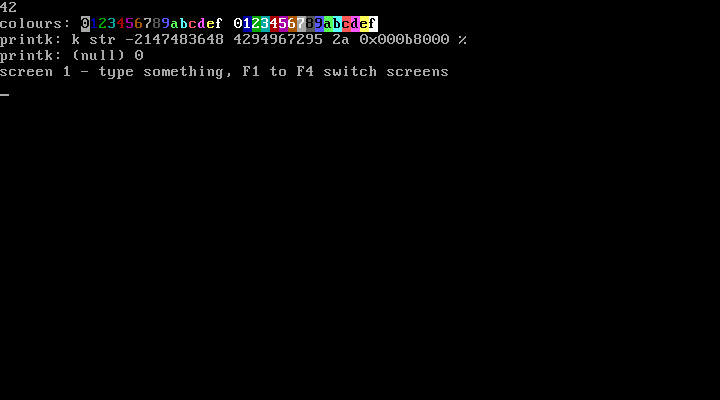
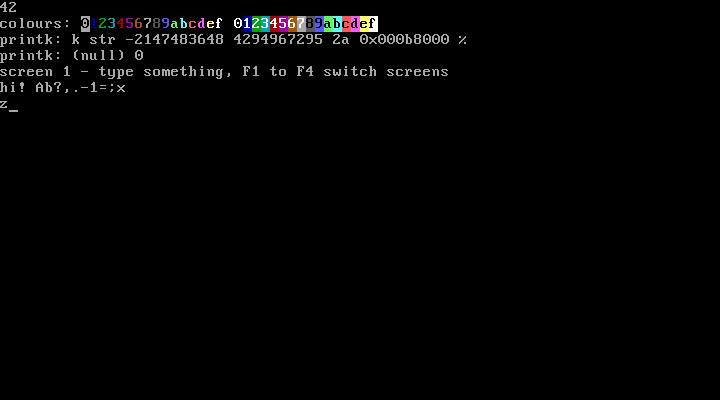
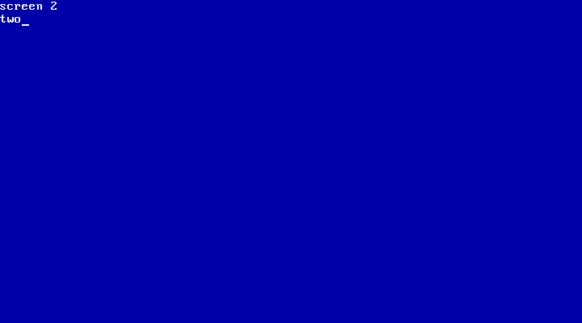

# kfs-1

A minimal i386 kernel for the 42 project KFS_1 ("Grub, boot and screen"). GRUB boots it and it prints `42` on the screen. All five bonuses are included: scrolling and cursor, colours, `printk`, keyboard input and multiple screens.

The design and the reasons behind each choice are in [docs/DESIGN.md](docs/DESIGN.md).

## Dependencies

The kernel is built on Debian or Ubuntu, x86_64:

```sh
sudo apt install make nasm gcc gcc-multilib grub-pc-bin grub-common xorriso mtools qemu-system-x86
```

| Package | Used for |
|---|---|
| `nasm` | assembling the boot code |
| `gcc`, `gcc-multilib` | compiling 32-bit C |
| `grub-pc-bin`, `grub-common`, `xorriso`, `mtools` | building the bootable ISO with `grub-mkrescue` |
| `qemu-system-x86` | running the kernel |

## Build and run

| Command | Effect |
|---|---|
| `make` | Compile and link `build/kernel.bin` |
| `make iso` | Build the bootable image `build/kfs.iso` |
| `make run` | Boot the ISO in QEMU, with the emulated screen drawn as text in the terminal |
| `make clean` | Remove object files |
| `make fclean` | Remove all build output |
| `make re` | Rebuild from scratch |

To leave `make run`, press `Esc` then `2` to reach the QEMU monitor, type `quit` and press Enter.

To open a graphical window instead: `qemu-system-i386 -cdrom build/kfs.iso`.

`CC`, `LD` and `AS` can be overridden, for example `make CC=i686-elf-gcc LD=i686-elf-ld`.

## How it boots

1. The firmware starts GRUB from the ISO.
2. GRUB reads `grub.cfg` and loads `/boot/kernel.bin`. It recognises the kernel by the Multiboot 1 header (magic `0x1BADB002`) that `linker.ld` places at the start of the code, within the first 8 KiB of the file where GRUB looks for it.
3. GRUB puts the kernel at 1 MiB, switches the CPU to 32-bit protected mode and jumps to `_start` in `src/boot.s`.
4. `_start` points the stack pointer at the kernel's own 16 KiB stack and calls `kmain`.
5. `kmain` in `src/kernel.c` clears the screen and writes `42` through the screen module, followed by a colour sample and a few `printk` lines.
6. `kmain` then loops forever, reading the keyboard and printing what is typed. If it ever returned, `_start` would disable interrupts and halt the CPU.

## Layout

```
Makefile
linker.ld        places the Multiboot header first, kernel at 1 MiB
grub.cfg         one menu entry: multiboot /boot/kernel.bin
src/
  boot.s         Multiboot header, stack, _start
  kernel.c       kmain: boot messages, then the keyboard loop
  vga.c          screen: write, colours, scrolling, cursor, virtual screens
  keyboard.c     PS/2 keyboard, read by polling
lib/
  string.c       strlen, strcmp, memset, memcpy
  printk.c       formatted print
include/
  types.h        fixed-width integer types, size_t
  io.h           inb, outb
  stdarg.h       variadic arguments, from compiler builtins
  vga.h
  keyboard.h
  printk.h
  string.h
docs/
  DESIGN.md
  screenshots/
```

## The screen

In VGA text mode the screen is 80 columns by 25 rows, stored as an array of 16-bit cells at physical address `0xB8000`. The low byte of a cell is the character and the high byte is its colour: background in the high four bits, foreground in the low four. Writing to that memory is all it takes to display text, so `src/vga.c` needs no driver setup.

## Compiler flags

```
-m32 -std=gnu99 -ffreestanding -fno-builtin -fno-stack-protector -fno-pie -nostdlib -nodefaultlibs -Wall -Wextra -Werror
```

The kernel is linked with `ld -m elf_i386 -T linker.ld -nostdlib`, so no host library and no host linker script is involved.

## Bonuses

### Scrolling and cursor

When output passes the last row, the screen scrolls up by one line. After a line that ends with a newline, the bottom row is the empty line holding the cursor, as in a terminal. The blinking hardware cursor always sits where the next character will go. It is moved by writing the position to the VGA CRT controller (ports `0x3D4` and `0x3D5`).

### Colours

`vga_set_color(fg, bg)` picks the foreground and background from the 16 VGA colours. `vga_clear()` fills the screen with the current background. The second line shown at boot prints one digit in each foreground colour, then one in each background colour.

By default the VGA card uses the top bit of the colour byte to make text blink, which leaves only 8 backgrounds. The kernel turns blinking off so that all 16 are available.

### printk

`printk(fmt, ...)` in `lib/printk.c` writes formatted text to the screen. It supports `%c`, `%s`, `%d`, `%u`, `%x`, `%p` and `%%`. A NULL string prints as `(null)`. Variadic arguments come from compiler builtins (`include/stdarg.h`), not from a host header.

### Keyboard

Whatever is typed appears on the screen. The layout is US QWERTY. Shift and Caps Lock work, Enter starts a new line and Backspace erases the previous character. Backspace only erases what was typed: the text printed by the kernel, including `42`, stays.

The keyboard is read by polling the PS/2 controller (ports `0x60` and `0x64`) in a loop. Interrupts are not used, because the interrupt table belongs to a later KFS project.

### Multiple screens

There are four virtual screens. Each keeps its own text, cursor position and colours.

| Key | Screen |
|---|---|
| `F1` | screen 1 (shown at boot) |
| `F2` | screen 2 |
| `F3` | screen 3 |
| `F4` | screen 4 |

## Proof

The ISO booted in QEMU:



After typing on screen 1:



Screen 2, with its own colours and text:



Screen 4 after typing 30 lines, scrolled:


